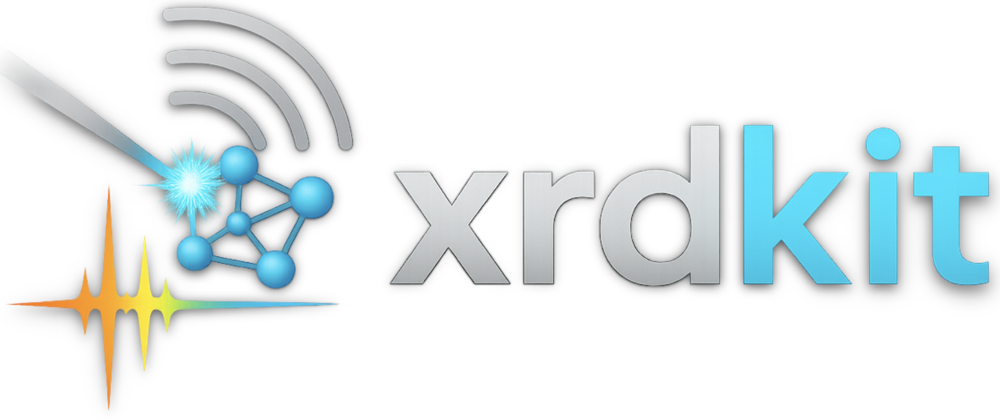

<p align="center">
  
</p>

# xrdkit

Interactive XRD reference patterns from five sources, mixed in a single figure:

- **Built-in reference phases** — eight PEMWE / OER phases (tabulated line lists and COD structures)
- **Local structure files** — CIF, POSCAR / CONTCAR, `.vasp`, `.json`, `.xyz`, `.xsf`
- **Crystallography Open Database (COD)** — search by formula, no API key
- **Materials Project** — search by formula, free API key
- **Measured or computed diffractograms** — `.xy`, `.csv`, `.txt`, `.dat`, `.tsv`, PANalytical `.xrdml`, Bruker `.brml`, Excel `.xlsx` (one pattern per sheet)

plus analysis of measured patterns: peak table, Kα2 stripping, Pawley cell refinement with space-group model comparison, Williamson–Hall size/strain, zoom panels, and database matching of unassigned peaks.

A browser GUI (Streamlit) for interactive use, a command-line entry point for batch rendering, and a small Python API. Vector PDF and animated GIF export.

## Try it in the browser,

*👉 Live app: https://xrdkit.streamlit.app*

  [](https://xrdkit.streamlit.app)

  Open the link and use XRDKit directly in your browser; nothing to install. Tick
  reference phases, upload a measured pattern, and export high-quality
  figures. Deployment notes (Streamlit Cloud / Hugging Face / self-hosted) are in
  [`DEPLOY.md`](DEPLOY.md).

## Install

Clone and install in a fresh environment:

```bash
git clone https://github.com/NabKh/XRDKit.git
cd XRDKit
pip install -e .            # installs xrdkit + dependencies
```

The distribution is named `pyxrdkit`, because the name `xrdkit` on PyPI belongs to an unrelated project. The import name and the command are still `xrdkit`.

Or without editable install:

```bash
pip install -r requirements.txt
```

Python 3.10+ recommended.

## Launch the GUI

```bash
python launch.py
```

Browser tab opens at `http://localhost:8501`. Pick built-in phases on the left, upload or search on the right, the plot updates live, click Download PDF / Download GIF.

## Built-in reference phases

| Phase | Source | Space group |
|---|---|---|
| Pt | PDF 04-0802 | Fm-3m |
| Ir | PDF 06-0598 | Fm-3m |
| α-Ti | PDF 44-1294 | P6₃/mmc |
| TiO₂ rutile | PDF 21-1276 | P4₂/mnm |
| TiO₂ anatase | PDF 21-1272 | I4₁/amd |
| IrO₂ rutile | COD 1548817 (Zhao & Kulik, JCTC 14, 670, 2018) | P4₂/mnm |
| RuO₂ rutile | COD 1000058 (Bolzan et al., Acta Cryst. B 53, 373, 1997) | P4₂/mnm |
| TiO₂ brookite | COD 9004137 (Meagher & Lager, Can. Mineral. 17, 77, 1979) | Pbca |

The first five are tabulated line lists: positions from the lattice parameters via Bragg's law, relative intensities as recorded in `xrdkit/core.py` under the cited PDF number (not re-checked against the licensed database). The last three are computed from the cited COD structures with `pymatgen` (kinematic random powder, isotropic B from the CIF U_eq), so their intensities follow the selected wavelength. Wavelength is switchable.

## Features

| Feature | Where |
|---|---|
| Wavelength dropdown (Cu / Co / Mo / Cr Kα, synchrotron 1.0 Å) | sidebar |
| Kα1 / Kα2 doublet rendering (Δ2θ from λ ratio, 2:1 intensity) | sidebar |
| Crystallite-size slider → Scherrer FWHM | sidebar |
| pseudo-Voigt η mixing | sidebar |
| 2θ range | sidebar |
| Linear background slope | sidebar |
| (h k l) labels on peaks with intensity threshold | sidebar |
| Intensity axis: linear, √I or log (weak and impurity peaks) | sidebar |
| Stacked-offset vs single-baseline overlay | sidebar |
| Sticks (Dirac) plus smooth profile, independently toggleable | sidebar |
| Peak list table — 2θ, d-spacing, intensity, hkl, source | beneath plot, CSV download |
| Per-phase structural info (lattice, space group, source) | beside plot |
| **Observed − simulated difference** (SNIP background, zero-shift align, NNLS phase scaling, residual + R_p / overlap) | beneath plot |
| PDF export (vector, editable text) | beside plot |
| GIF export (cumulative reveal) | beside plot |

### Observed − simulated difference

The Rietveld-style observed / calculated / difference figure: the selected
reference phases are background-subtracted (SNIP), zero-shift aligned, and scaled
to a measured pattern by **non-negative least squares**, then the residual is
drawn below with colour-matched Bragg tick rows. Reported `overlap` (cosine) and
`R_p` are pattern-similarity scores for kinematic reference overlay — **not** a
Rietveld goodness-of-fit. Three worked examples (Pt, rutile TiO₂, nanocrystalline
IrO₂) with figures and data are in
[`examples/observed_simulated_difference/`](examples/observed_simulated_difference/).

```python
from xrdkit import builtin_phases, load_measured, compute_difference, make_difference_plot

lib = builtin_phases()
meas = load_measured("sample.xy")
data = compute_difference(meas, [lib["IrO₂ rutile"]], wavelength_A=1.54184,
                          crystallite_nm=3.0, tt_range=(20, 90))
fig, _ = make_difference_plot(data)        # overlap, R_p, scales in `data`
```

## Analysis of measured patterns

Below the plot, the **Analysis of measured patterns** section works on any uploaded measured pattern:

| Tab | What it gives |
|---|---|
| Peak table | Automatic peak search: 2θ, d, height, FWHM, area (CSV) |
| Kα2 stripping | Rachinger removal of the Kα2 component |
| Cell refinement (Pawley) | Whole-pattern fit of candidate space groups; lattice parameters and volume with e.s.d.s, Rwp / GoF, models ranked by BIC; obs/calc/diff plot (PDF). Includes the five ABO₃ octahedral-tilt models (Pm-3m, R-3c, Pnma, Imma, I4/mcm), any loaded CIF phase, and additional phases refined jointly for multiphase samples |
| Williamson–Hall | Crystallite size and microstrain from β cosθ vs 4 sinθ, with instrumental-broadening correction (constant FWHM or Caglioti U, V, W from a LaB₆ / Si standard) |
| Zoom panels | Side-by-side 2θ windows for all samples, linear / √I / log, optional background subtraction (PDF) |
| Unassigned peaks → database | Peaks not explained by the selected phases, matched against COD / Materials Project |

The Pawley fit refines the cell (plus zero / displacement, Caglioti widths, pseudo-Voigt η, Chebyshev background); reflection intensities are free, so no atomic model is needed. Intensities and background are solved linearly at each step (variable projection, non-negative least squares).

```python
from xrdkit import load_measured_excel, compare_models, PEROVSKITE_MODELS

for m in load_measured_excel("samples.xlsx"):            # one pattern per sheet
    results, table = compare_models(m, list(PEROVSKITE_MODELS),
                                    wavelength=(1.54056, 1.54439, 0.5),  # Cu Kα1/Kα2
                                    tt_range=(20, 90))
    best = next(r for r in results if getattr(r, "model", None) == table["model"].iloc[0])
    print(m.name, best.model, best.status, best.cell[:3], best.cell_sys[:3])
    best.to_dict()                 # JSON-safe summary; best.profile_frame() → obs/calc/diff
```

How to read the results:

- **Rank by ΔBIC_eff.** Pawley residuals are serially correlated over a peak width (Durbin–Watson well below 2), so the nominal number of points overstates the evidence. `BIC_eff` uses N_eff = N/τ, τ from the residual autocorrelation of the best fit, and the same N_eff for every model; ΔBIC_eff > 10 is strong evidence. The same τ inflates the e.s.d.s (column `esd ×`).
- **Status `unexplained`** means the model does not beat a background-only fit (no signal, or the cell does not index the peaks); **`poor_fit`** means GoF > 3.
- **Rwp is relative to total counts**: a high background gives a low Rwp even for a mediocre fit. `Rwp net` is computed on the background-subtracted pattern; judge the fit by it and by the difference curve.
- **Unindexed peaks** (spikes in the difference curve with no tick under them) mean another phase. Identify it in the database tab and add it as an additional phase before quoting the cell.
- **e.s.d.s are statistical only.** Zero offset and sample displacement are nearly collinear; the fit refines one and repeats with the other, and the cell difference is reported as `cell_sys` — usually larger than the e.s.d. Pass `zero_fixed` from a Si / LaB₆ standard to remove it. Wavelength errors are not included.
- Pnma and Pbnm are the same space group in two settings. Groups whose extra reflections are only weak superstructure lines (e.g. R-3 vs R-3c: their reflection lists differ) are usually not distinguishable from lab-XRD Pawley fits; that needs Rietveld or neutron data.
- **A face-centred pattern fits Pm-3m**: an fcc metal, rock salt or fluorite indexes on a primitive cubic cell. `compare_models` warns when the strong lines carry almost no mixed-parity pseudocubic intensity (the 110 is the strongest perovskite line).

Williamson–Hall: the fit is weighted by the FWHM e.s.d.s, and its validity test is the reduced χ², not R². A size-only sample has slope ≈ 0 and therefore R² ≈ 0 while being perfectly described. When the points scatter more than √10 × their e.s.d.s about the line (χ²_red > 10), the broadening is not one isotropic size plus strain (anisotropic size or strain, overlapping or split lines), and D and ε are not reported. Negative strain is flagged separately.

## Command line

```bash
# all built-in phases at Cu Kα, 30 nm crystallites, 20–90°
xrdkit --out .

# only Pt + IrO2, with (hkl) labels and Kα1/Kα2 doublet
xrdkit --phase Pt --phase "IrO₂ rutile" --show-hkl --kalpha12

# mix sources: a built-in, a CIF, an MP entry, a measured pattern
xrdkit --phase Pt --cif my.cif --mp mp-126 --measured sample.xy

# Co Kα over a wider window
xrdkit --wavelength "Co Kα" --tt-min 10 --tt-max 110
```

Outputs `xrdkit_stacked.pdf`, `xrdkit_overlay.pdf`, `xrdkit.gif` in `--out`.

Pawley model comparison without the GUI:

```bash
# every sheet of a workbook, perovskite tilt models + a CIF candidate, Cu Kα1/Kα2
xrdkit analyze samples.xlsx --models Pm-3m R-3c Pnma my_phase.cif --tt-min 20 --tt-max 90 --out results/
```

For each pattern this writes `<pattern>.json` with every model (cell, e.s.d., `cell_sys`, Rwp, Rwp net, GoF, Durbin–Watson, BIC_eff, status, warnings). It also records provenance: the input file SHA-256, sheet, wavelength, 2θ range, offset model and xrdkit version. For the best model it writes `<pattern>_profile.csv` (2θ, obs, calc, background, diff) and `<pattern>_reflections.csv` (2θ, hkl, intensity). Options are `--offset zero|displacement`, `--zero-fixed`, `--a-pc` and `--strip-ka2`.

## Python API

```python
from xrdkit import builtin_phases, from_cod_id, make_figure, save_pdf, peaks_table

lib = builtin_phases()
phases = [lib["Pt"], lib["IrO₂ rutile"]]
phases.append(from_cod_id("9005887"))   # Co3O4 spinel from COD

fig, ax = make_figure(phases, wavelength_A=1.54184,
                     crystallite_nm=30, tt_range=(20, 90),
                     show_hkl_labels=True, kalpha12=True)
save_pdf("pattern.pdf", phases=phases, wavelength_A=1.54184)

print(peaks_table(phases, 1.54184, (20, 90))[:3])
# [{'Phase': 'Pt', '2θ (°)': 39.764, 'd (Å)': 2.2657, 'I (%)': 100.0, 'hkl': '1 1 1', ...}, …]
```

## Scope and honest limits

xrdkit produces **kinematic random-powder reference patterns** for phase identification, peak-position diagnostics, figure composition, and observed−simulated difference inspection, and analyses measured patterns (Pawley cell refinement, Williamson–Hall, peak search). The difference tool background-subtracts (SNIP), zero-shift aligns, and least-squares scales the reference to a measurement, reporting `R_p` / cosine overlap as *similarity* scores. It does **not** do:

- Rietveld structural refinement: atomic positions, occupancies, oxygen content, tilt angles (use GSAS-II / FullProf / TOPAS). The Pawley tab refines the unit cell only
- quantitative phase analysis (the NNLS scales are a relative-abundance proxy, not weight fractions)
- preferred-orientation modelling
- texture / pole-figure analysis

DFT-relaxed Materials Project lattices can be 1–2 % larger than experimental, shifting peaks 0.1–0.3°. Prefer experimental (COD) structures when peak positions matter. Amorphous and disordered phases (commercial Heraeus IrO₂, anodised TiO₂) are not in any structural database — no synthetic reference can reproduce them without a structural model.

See [`docs/methodology.md`](docs/methodology.md) for the full methodology note (Bragg's law, structure factor, Scherrer, pseudo-Voigt, what an experimentalist must provide).

## Repository layout

```
xrdkit/
├── pyproject.toml              installable Python package
├── README.md
├── DEPLOY.md                   host as a no-install web app (Streamlit Cloud / HF / self)
├── ROADMAP.md                  prioritised scientific feature menu
├── LICENSE                     MIT
├── CITATION.cff
├── requirements.txt
├── launch.py                   one-command GUI launcher
├── app.py                      Streamlit entry point
├── .streamlit/config.toml      hosted-app theme
├── xrdkit/
│   ├── __init__.py             public API
│   ├── core.py                 lattice / Bragg / pseudo-Voigt / Scherrer
│   ├── db.py                   Phase abstraction, CIF / COD / MP loaders
│   ├── plot.py                 figure rendering, GIF, peak table, difference tool, file readers
│   ├── analysis.py             peak search, Kα2 stripping, Pawley refinement, Williamson–Hall, database matching
│   └── cli.py                  command-line entry
├── examples/
│   └── observed_simulated_difference/   3 worked examples (data + script + figures)
├── tests/
│   └── test_smoke.py
└── docs/
    └── methodology.md
```

## Tests

```bash
pip install -e .[dev]
pytest -q
```

## Comparison to existing tools

xrdkit is a **figure composer and quick-analysis tool**, not a Rietveld package.

| Tool | What it does | xrdkit overlap |
|---|---|---|
| HighScore / Match! (commercial) | Phase ID + Rietveld + database | xrdkit covers the phase-ID and reference-overlay parts, free, open-source |
| GSAS-II / FullProf / TOPAS | Full Rietveld refinement | xrdkit does Pawley (cell-only) refinement and space-group model ranking; use these for structure refinement |
| PyXRD | Clay-mineral profile fitting | unrelated scope |
| pymatgen's XRDCalculator | Computes patterns from a Structure | xrdkit *uses* this and wraps it in a multi-source GUI |

## Author

**Nabil Khossossi**,
Researcher | AI-Driven Materials Discovery | Computational Chemistry

## License

MIT — see `LICENSE`.

## Citation

If xrdkit helps with a publication, please cite this repository — see `CITATION.cff` for BibTeX / format-of-choice.
